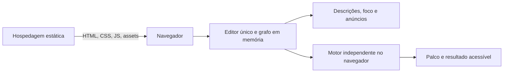

# Arquitetura do Jyboia

Status em 18/11/2026: MVP público estático. `apps/web/dist` contém a aplicação; o navegador monta o editor único, mantém o grafo somente em memória e executa o motor localmente. Não há contas, API, banco ou persistência no navegador no fluxo público. Recarregar inicia uma página vazia. Por solicitação posterior, o aviso visual e os painéis de organização/consulta foram retirados; a paleta, o teclado do Blockly, os anúncios de execução e a descrição do palco permanecem.

O código de persistência da D-16 permanece preservado fora do fluxo público. `EditorPage` não importa `useProjects`, `ProjectActions` nem cliente HTTP; a antiga tela de health não é roteada. A PoC `/experiments/editor` é exclusiva de desenvolvimento. `pnpm dev` e `pnpm build` não iniciam/compilam o backend. O build estático usa os pacotes TypeScript compartilhados e não precisa de `.env` ou credenciais. Ver [STATIC_MVP](STATIC_MVP.md) e D-17.

## Organização e dependências

| Diretório | Responsabilidade |
| --- | --- |
| `apps/web` | React/TypeScript; MVP estático com editor único, foco, anúncios e palco. Cliente HTTP preservado, fora do fluxo público. |
| `apps/api` | Código Node.js/TypeScript, REST e PostgreSQL preservado para evolução; fora do MVP e do deploy estático. |
| `packages/block-engine` | Modelo, catálogo de comandos, conexões, validação, serialização e interpretação. Exportações separadas `model` e `runtime`. |
| `packages/shared` | DTOs, esquemas de transporte e códigos de erro da API, sem serviços de servidor. |
| `docs` | Especificações, decisões e diagramas. |

O motor não depende de `shared` nem das aplicações. `shared` pode importar `block-engine/model` para compor contratos, sem importar o interpretador. As aplicações consomem ambos; não importam uma à outra. Tipos de blocos pertencem ao motor e são reutilizados, não redefinidos em `shared`. Exportações distintas evitam carregar execução em consumidores que precisam apenas de validação.

Quando a integração futura for autorizada, frontend e backend comunicarão exclusivamente por HTTP/JSON. No MVP não há comunicação entre eles. Compartilhar esquemas não permite chamar serviços internos do servidor. React, Blockly, rede, APIs do navegador e banco ficam fora do núcleo do motor.

## Modelo modular e arquitetura alvo

O controlador transacional completo abaixo é arquitetura alvo; hoje Blockly mantém o grafo mutável, projetado para o modelo independente. Serialização e importação preservadas servem à evolução futura e testes; não significam salvamento no MVP.

O estado de domínio é um `ProjectDocument`, conforme [BLOCK_MODEL](BLOCK_MODEL.md). Um controlador recebe operações semânticas de inserir, conectar, editar parâmetro e remover. Mouse e teclado acionam as mesmas operações. O adaptador traduz eventos Blockly e projeta o estado confirmado no workspace, com controle de origem para evitar ciclos de atualização.

Blockly mantém estado interno de apresentação, mas não define o formato persistido. Uma transação de edição aplica regras, atualiza o documento, incrementa revisão local e sincroniza workspace e semântica. Em falha de adaptação, preservar o último documento válido e informar o erro. Edições parciais de campo permanecem em estado de formulário até confirmação, sem substituir valores tipados por strings inválidas.

Componentes: paleta; workspace/adaptador; controlador de edição; estado do projeto; projeção semântica e gestor de foco; controlador de execução; palco e descrição; sequência consultável e anunciador; cliente HTTP. A projeção acessível usa IDs e conexões do documento. Não há segundo editor ou ordem inferida do desenho.

## Execução no navegador

“Iniciar programa” captura uma cópia imutável do documento, valida executabilidade e cria `runId`. O motor prepara uma sequência a partir das conexões. A interface publica a sequência textual e solicita anúncio antes de consumir passos. Isso não equivale a aguardar a fala do leitor de tela.

O controlador no navegador solicita um passo por vez a um interpretador incremental. Entre passos, devolve controle ao navegador para navegação e cancelamento. O motor é síncrono por passo; relógio monotônico e agendamento são fornecidos pelo controlador. Worker é alternativa futura se medições demonstrarem necessidade, mantendo o contrato de eventos.

Durante execução, edição fica indisponível com explicação acessível; consulta, navegação e “Parar programa” permanecem disponíveis. Cada execução começa na posição e direção atuais do personagem, sem centralizá-lo. Eventos com `runId` antigo são ignorados; apenas uma execução fica ativa. Animação não muda a ordem ou semântica dos eventos.

## Backend e persistência — preservados, fora do MVP

Fluxo: rota HTTP → validação de contrato → serviço de projetos → repositório → PostgreSQL. Validar estrutura e limites também no servidor. Guardar metadados relacionais e documento `jsonb`; salvar todo o documento em transação com controle otimista de revisão. Ver [API_CONTRACTS](API_CONTRACTS.md).

Não há acesso direto do navegador ao banco nem endpoint de execução. Aplicações podem ser compiladas e implantadas independentemente, respeitando contratos. Preferir encaminhar `/api` no mesmo domínio; origens distintas exigem CORS explícito, que não substitui autorização.

## Riscos e pendências

- Blockly é candidato preferencial condicionado a protótipo acessível; o adaptador permite substituição.
- Sincronização pode perder conexões ou foco: testar transações, importação e edição por mouse e teclado.
- Leitores de tela podem agrupar atualizações de regiões vivas: manter sequência consultável e validar anúncios reais.
- Limites iniciais precisam de medição em dispositivos escolares; ver BLOCK_MODEL.
- Persistência para usuários reais depende de identidade, autorização por projeto e retenção. UUID e CORS não protegem projetos. Não expor publicamente antes dessa definição, sem presumir contas fora do escopo.
- pnpm, Vite, Fastify e Prisma foram escolhidos na D-10. Biblioteca de schemas de domínio permanece em aberto; health utiliza JSON Schema explícito.

## Diagramas históricos e verificação futura

Os diagramas abaixo descrevem a arquitetura ampliada anterior. Para o MVP vigente, use o diagrama estático acima; API e banco não devem ser publicados. Os diagramas de persistência não são requisitos de deploy atual.

A experiência em `/experiments/editor` está documentada em [EDITOR_POC](EDITOR_POC.md) e D-11. Ela usa um grafo Blockly mutável com projeção de consulta independente, sem persistência. Não demonstra ainda o ciclo transacional completo entre domínio, importação e editor aqui proposto.

- [Arquitetura geral](diagrams/01-system.md)
- [Componentes do frontend](diagrams/02-frontend.md)
- [Blocos e conexões](diagrams/03-blocks.md)
- [Execução e anúncios](diagrams/04-execution.md)
- [Salvar e carregar](diagrams/05-persistence.md)

Verificar isolamento do motor sem DOM/banco, equivalência de edição por mouse e teclado, HTTP conforme OpenAPI, round-trip e conflitos de revisão. A aceitação assistiva está em [ACCESSIBILITY](ACCESSIBILITY.md). Documentação não demonstra funcionamento da aplicação.

## API local preservada para evolução

A API atual usa /api/projects e os campos name, description, workspaceData e formatVersion, conforme a solicitação de implementação e D-12. DTOs ficam em shared/projects; validação independente em block-engine/validation (tipos em model). Listagem/exclusão e paginação foram acrescentadas. PUT/DELETE verificam revisão atomicamente. O backend não depende de lógica visual e só aceita host loopback enquanto não existe política de acesso. Evidências em BACKEND_VALIDATION.
