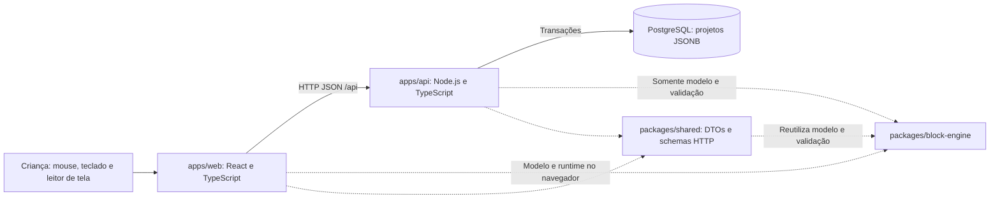

# Arquitetura geral

Setas contínuas indicam fluxo em execução; tracejadas, uso de pacotes. Arquitetura planejada.

O motor não depende das aplicações ou do banco. Não há acesso direto do frontend ao PostgreSQL nem execução de programas no servidor.
