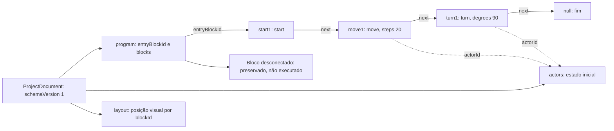

# Blocos e conexões v1

Este desenho ilustra referências, não a ordem física da lista. `start` não recebe predecessor; comandos têm no máximo um. Proibir ciclos e referências inexistentes. A cadeia alcançável torna-se o plano linear de execução; `layout` nunca define a ordem. O bloco desconectado é ilustrativo, não pertence ao exemplo JSON de BLOCK_MODEL.
