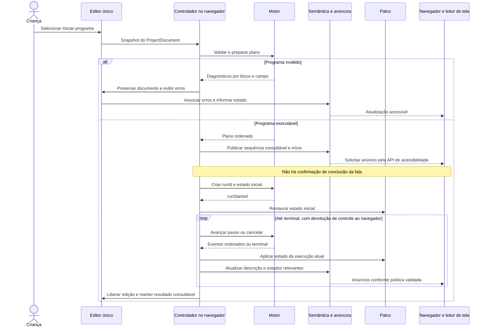

# De Iniciar programa ao palco e leitor de tela

Parar cancela antes do próximo passo; eventos e mensagens de `runId` anterior são descartados. A ordem de eventos é verificável; a fala efetiva requer testes manuais e não é garantida por este diagrama.
