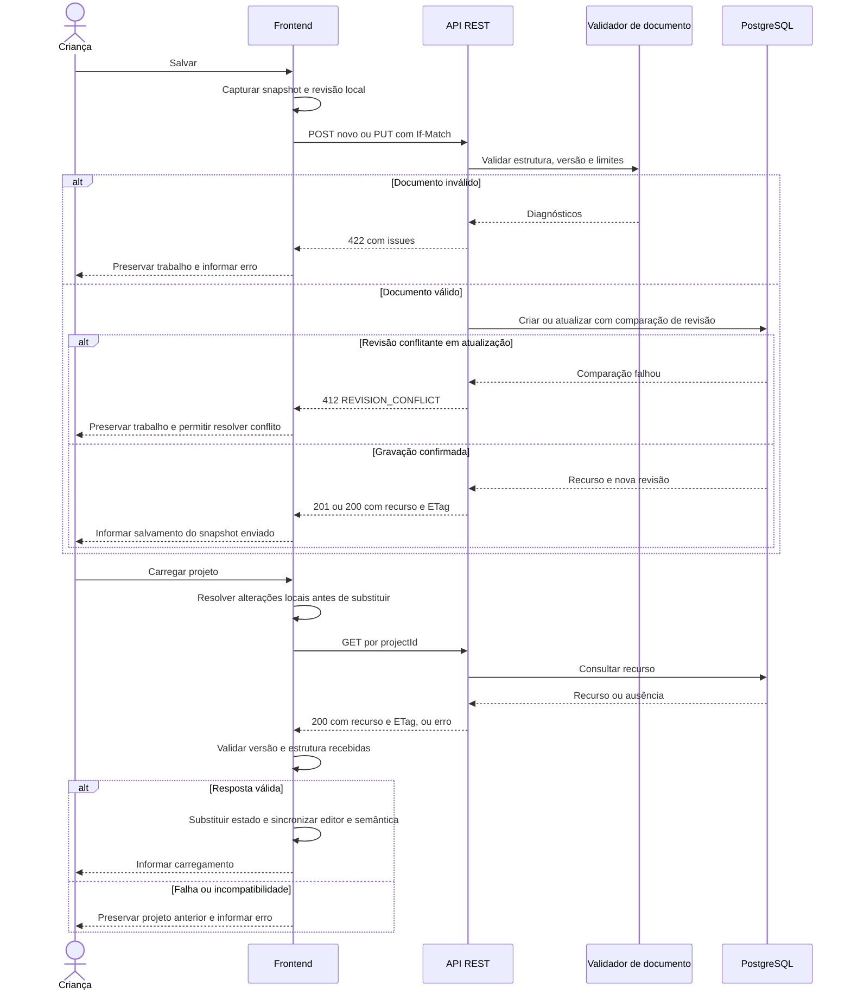

# Salvar e carregar projetos

Timeout pode deixar resultado de gravação desconhecido; não repetir criação automaticamente. Autorização por projeto é condição pendente antes da exposição a usuários reais, não representada como já implementada.
