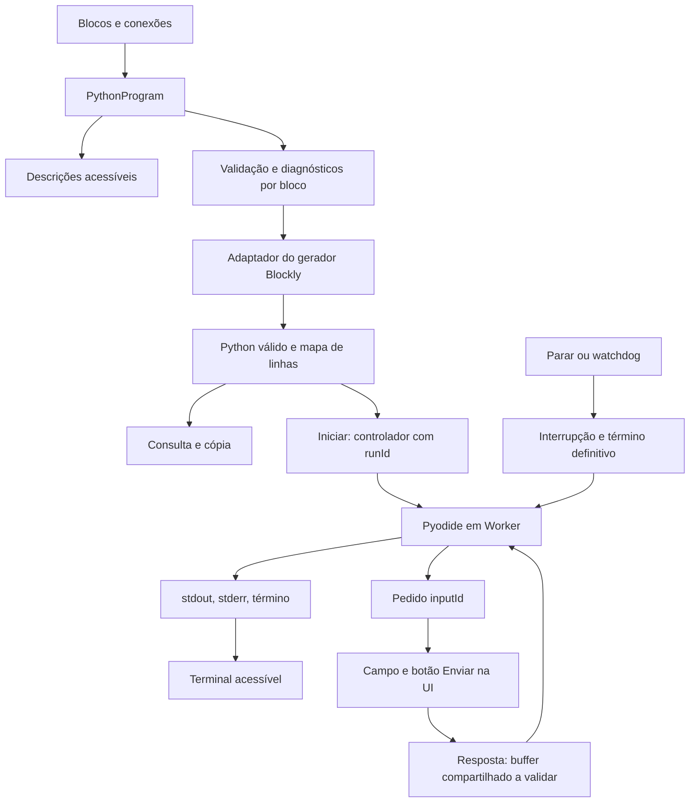

# Fluxo Python alvo — ainda não implementado

O caminho de entrada depende de prova com isolamento de origem e espera somente no Worker. A UI não bloqueia. Mensagens antigas são descartadas por runId/inputId. Consulte [limitações e segurança](../../apps/web/docs/PYTHON.md).
